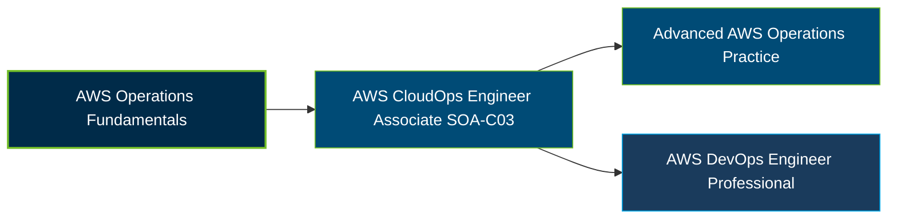

# AWS Certified CloudOps Engineer - Associate (SOA-C03) Certification Exam Guide

A dedicated, comprehensive study guide and cloud operations reference repository for candidates preparing for the **AWS Certified CloudOps Engineer - Associate (SOA-C03) Certification Exam**.

---

## Exam Overview

The AWS Certified CloudOps Engineer - Associate certification validates the ability to deploy, manage, monitor, secure, and troubleshoot workloads on AWS, including reliability, networking, and operational performance.

- **Exam Format**: Multiple-choice and multiple-response questions; testing center or online proctored exam
- **Target Audience**: Cloud operations engineers, cloud support engineers, systems administrators, migration specialists, and cloud consultants
- **Prerequisites**: No formal prerequisite; AWS recommends approximately one year of experience deploying, managing, and operating AWS workloads

---

## Core Exam Domains & Knowledge Areas

### 1. Monitoring, Logging, Analysis, Remediation, and Performance Optimization

- Monitoring workloads and analyzing metrics, logs, and operational events.
- Troubleshooting issues and implementing remediation procedures.
- Optimizing workload performance and operational visibility.

### 2. Reliability and Business Continuity

- Implementing scalability, elasticity, and highly available environments.
- Managing backups, recovery, and disaster recovery procedures.
- Maintaining workload reliability and business continuity.

### 3. Deployment, Provisioning, and Automation

- Provisioning and managing resources with AWS CloudFormation and infrastructure as code.
- Automating operational tasks and deployment workflows.
- Using AWS management tools and automation to maintain workloads.

### 4. Security and Compliance

- Managing IAM permissions, roles, and secure access controls.
- Protecting data through encryption, secrets management, and security services.
- Implementing compliance policies and monitoring security configurations.

### 5. Networking and Content Delivery

- Configuring and troubleshooting VPCs, routing, DNS, and connectivity.
- Managing network security controls, firewalls, and hybrid connectivity.
- Monitoring network performance and configuring content delivery services.

---

## Certification Path

This is a suggested learning progression, not a mandatory certification sequence. Advanced operations practice is a learning option, and the DevOps Engineer - Professional certification is a separate AWS credential.

---

## Recommended Practice & Study Resources

Combine official AWS exam preparation materials with hands-on practice in monitoring, automation, networking, and operational troubleshooting.

- **CertsGate**: Explore [SOA-C03 certification preparation resources](https://certsgate.com/exams/amazon/soa-c03) for supplementary study materials and practice questions.
- **Practical AWS Study**: Use the [Amazon CloudWatch documentation](https://docs.aws.amazon.com/AmazonCloudWatch/latest/monitoring/WhatIsCloudWatch.html) to explore metrics, logs, alarms, dashboards, and workload monitoring.
